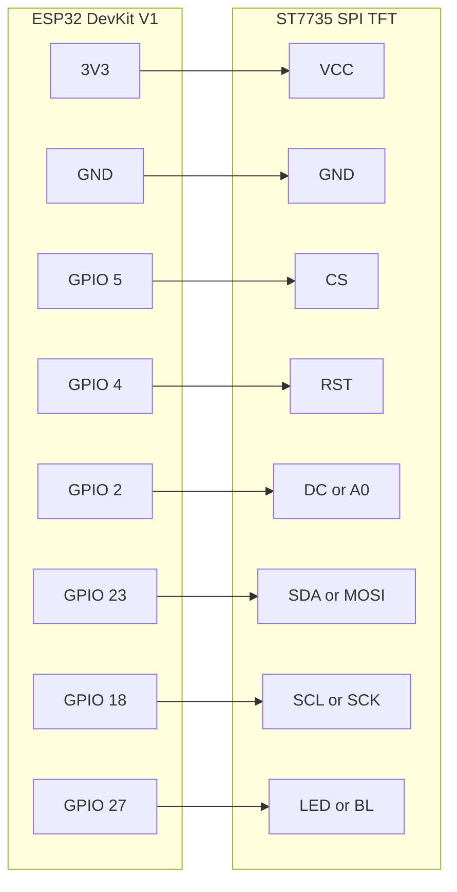

# Internet Clock

ESP32 internet clock with a 1.8-inch ST7735 TFT. It displays the local time and date using NTP and fetches current weather for Coimbatore from OpenWeatherMap.

## Circuit

Connect an ESP32 DevKit V1 to an ST7735 SPI TFT:

| ESP32 DevKit V1 | ST7735 TFT |
| --- | --- |
| 3V3 | VCC |
| GND | GND |
| GPIO 5 | CS |
| GPIO 4 | RST |
| GPIO 2 | DC / A0 |
| GPIO 23 | SDA / MOSI |
| GPIO 18 | SCL / SCK |
| GPIO 27 | LED / BL |

The display uses 3.3 V logic; do not connect its signal pins to 5 V. MISO/SDO is unused. TFT breakout labels vary by manufacturer, so check the labels on your module before wiring.

## Firmware Setup

1. Open `internet clock` in VS Code with the PlatformIO extension.
2. Copy `internet clock/include/secrets.example.h` to `internet clock/include/secrets.h` and fill in your Wi-Fi credentials and OpenWeatherMap API key. `secrets.h` is ignored by Git. Without it, the firmware builds with placeholder credentials.
3. Build and upload the `esp32dev` environment.

The project targets an ESP32 DevKit V1 and uses NTP plus the OpenWeatherMap current-weather API. Change the city and country in `internet clock/src/main.cpp` if needed.

## Enclosure

Enclosure files:

- [Separated lid assembly STL](Case%20model/ESP32_TFT_Enclosure_LID_separated.stl)
- [Enclosure body STL](Case%20model/esp32_tft_enclosure_body.stl)
- [Separated lid assembly 3MF](Case%20model/ESP32_TFT_Enclosure_LID_separated.3mf)